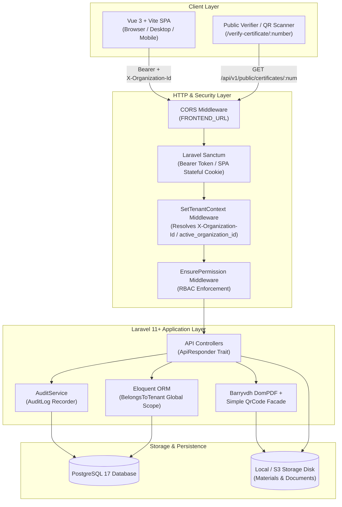
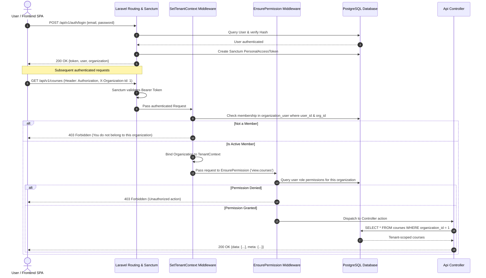
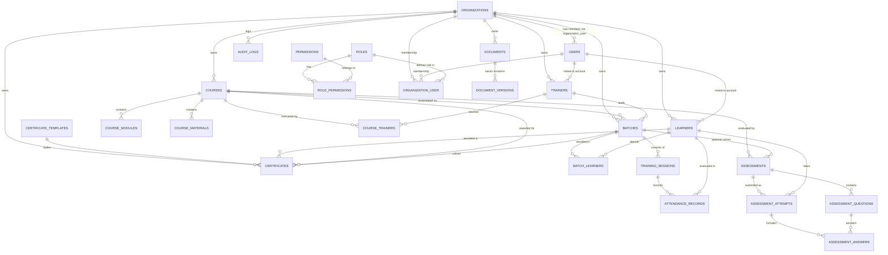
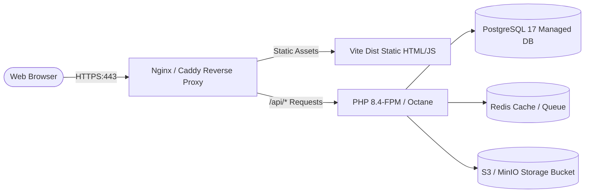
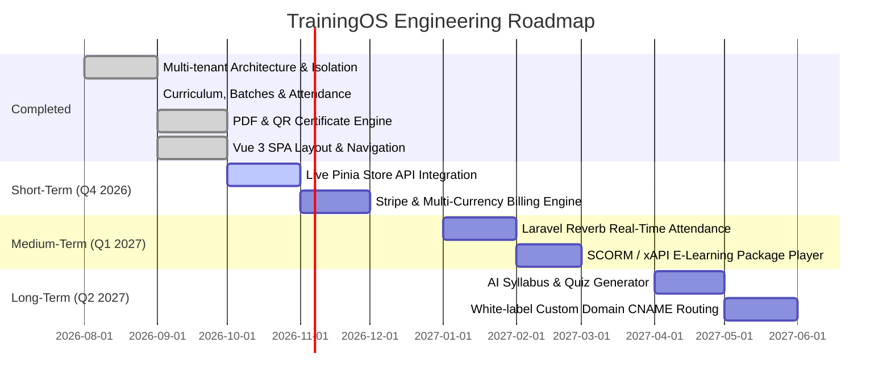

# TrainingOS — Enterprise Multi-Tenant Training Management SaaS

[](https://www.php.net/)
[](https://laravel.com/)
[](https://vuejs.org/)
[](https://www.typescriptlang.org/)
[](https://vitejs.org/)
[](https://www.postgresql.org/)
[](LICENSE)

> **TrainingOS** is a production-grade, multi-tenant Training Management SaaS platform architected for corporate academies, vocational institutes, professional consultancies, and commercial training providers. It streamlines the complete training lifecycle—from curriculum design and learner enrollment to batch scheduling, attendance recording, assessment grading, audit logging, and automated QR-verified PDF certificate issuance.

---

## 📑 Table of Contents

- [1. Executive Summary & Value Proposition](#1-executive-summary--value-proposition)
- [2. System Architecture & Engineering Design](#2-system-architecture--engineering-design)
  - [High-Level Architecture Diagram](#high-level-architecture-diagram)
  - [Multi-Tenant Data Isolation Strategy](#multi-tenant-data-isolation-strategy)
  - [Authentication & Tenant Context Resolution Flow](#authentication--tenant-context-resolution-flow)
- [3. Technology Stack](#3-technology-stack)
- [4. Repository & Directory Structure](#4-repository--directory-structure)
- [5. Core Features & Capabilities](#5-core-features--capabilities)
  - [Multi-Tenancy & Workspace Isolation](#multi-tenancy--workspace-isolation)
  - [Authentication & Role-Based Access Control (RBAC)](#authentication--role-based-access-control-rbac)
  - [Learner & Trainer Management](#learner--trainer-management)
  - [Course Authoring & Curriculum Management](#course-authoring--curriculum-management)
  - [Batch Scheduling & Calendar Operations](#batch-scheduling--calendar-operations)
  - [Attendance Tracking & Automated Progress](#attendance-tracking--automated-progress)
  - [Assessment & Examination Engine](#assessment--examination-engine)
  - [Certificate Generation & Public QR Verification](#certificate-generation--public-qr-verification)
  - [Document Vault & Version Control](#document-vault--version-control)
  - [Executive Analytics & Reporting](#executive-analytics--reporting)
  - [Audit Logging & Observability](#audit-logging--observability)
  - [Organization Settings & White-Label Customization](#organization-settings--white-label-customization)
- [6. Database Schema & Data Models](#6-database-schema--data-models)
  - [Entity-Relationship Diagram (ERD)](#entity-relationship-diagram-erd)
  - [Data Model Reference](#data-model-reference)
- [7. User Roles & Permission Matrix](#7-user-roles--permission-matrix)
- [8. REST API Reference](#8-rest-api-reference)
  - [Global Conventions & Response Standards](#global-conventions--response-standards)
  - [Authentication & Session Endpoints](#authentication--session-endpoints)
  - [Core Operations Endpoints](#core-operations-endpoints)
  - [Public Endpoints](#public-endpoints)
- [9. Prerequisites & Local Environment Setup](#9-prerequisites--local-environment-setup)
  - [Option A: Docker Compose Setup (Recommended)](#option-a-docker-compose-setup-recommended)
  - [Option B: Bare-Metal Setup](#option-b-bare-metal-setup)
- [10. Environment Variables Reference](#10-environment-variables-reference)
- [11. Development Commands & CLI Workflows](#11-development-commands--cli-workflows)
  - [Custom Artisan Commands](#custom-artisan-commands)
- [12. Frontend Integration & Architecture](#12-frontend-integration--architecture)
- [13. Testing & Quality Assurance](#13-testing--quality-assurance)
- [14. Security & Privacy Model](#14-security--privacy-model)
- [15. Production Deployment Guide](#15-production-deployment-guide)
- [16. Troubleshooting & FAQ](#16-troubleshooting--faq)
- [17. Limitations & Product Roadmap](#17-limitations--product-roadmap)
- [18. Contributing Guidelines](#18-contributing-guidelines)
- [19. License & Acknowledgements](#19-license--acknowledgements)

---

## 1. Executive Summary & Value Proposition

### The Problem
Traditional training institutions and corporate learning divisions struggle with fragmented toolchains: spreadsheets for attendance, disconnected learning management tools for course materials, generic form builders for quizzes, and manual certificate generation. This creates operational bottlenecks, data leaks between corporate clients, compliance failures, and unverifiable graduation credentials.

### The Solution: TrainingOS
**TrainingOS** centralizes training operations into a single multi-tenant platform. Designed with an API-first backend powered by **Laravel** and a responsive **Vue 3 + TypeScript** single-page application (SPA), TrainingOS manages the end-to-end educational lifecycle:

```text
Learners & Trainers ➔ Courses & Modules ➔ Batches & Sessions ➔ Attendance & Assessments ➔ PDF Certificates ➔ Public QR Verification
```

### Key Differentiators
1. **Multi-Tenancy by Design**: Strict row-level data segregation using Laravel Eloquent global scopes (`BelongsToTenant`) and session/header-based tenant context resolution.
2. **Deterministic PDF & QR Verification**: Automated DOMPDF certificate rendering coupled with base64 embedded SVG QR codes pointing to public, tenant-isolated verification URLs.
3. **Enterprise RBAC**: Six built-in roles (`owner`, `admin`, `manager`, `trainer`, `learner`, `client`) and 21 discrete permissions enforced server-side via custom middleware.
4. **Audit Trail**: Native tracking of critical mutations (issue/revoke certificate, attendance updates, course archives) capturing user ID, IP address, user agent, and contextual payload metadata.
5. **Modern Frontend Experience**: Powered by Vite, Vue 3 Composition API, Pinia state management, and Lucide icons with zero bloated CSS framework overhead.

---

## 2. System Architecture & Engineering Design

TrainingOS uses an API-first client-server architecture. The backend exposes a RESTful JSON API (`/api/v1`), while the frontend is a decoupled Vue 3 Single Page Application (SPA).

### High-Level Architecture Diagram



### Multi-Tenant Data Isolation Strategy

Data isolation in TrainingOS is enforced at the persistence layer to eliminate the risk of cross-tenant data leakage:

1. **Schema Strategy**: Shared Database, Shared Schema with discriminator column (`organization_id`). Every tenant-scoped model holds a foreign key reference to `organizations.id`.
2. **Eloquent Global Scope (`BelongsToTenant`)**:
   - The `BelongsToTenant` trait automatically hooks into `creating` events, assigning `$model->organization_id = app(TenantContext::class)->id()`.
   - Adds an Eloquent global scope (`tenant`), appending `WHERE {table}.organization_id = ?` to every query executed during the request lifecycle.
   - CLI commands, seeders, and administrative background tasks can safely bypass this scope via `withoutGlobalScope('tenant')` when required.
3. **Tenant Context Resolution (`SetTenantContext`)**:
   - Checks if the user is authenticated.
   - Evaluates the `X-Organization-Id` request header (or falls back to `$user->active_organization_id`).
   - Verifies through the `organization_user` pivot table that the authenticated user is an active member of the requested organization (`abort_unless(..., 403)`).
   - Binds the validated `Organization` model into Laravel's service container (`TenantContext`).

### Authentication & Tenant Context Resolution Flow



---

## 3. Technology Stack

### Backend
| Technology | Version | Purpose & Integration |
|---|---|---|
| **PHP** | `^8.2` (CLI 8.4 in Docker) | Primary programming language; typed properties, constructor property promotion, match expressions. |
| **Laravel Framework** | `^11.0` | Core MVC framework providing routing, Eloquent ORM, service container, migration engine, and validation. |
| **Laravel Sanctum** | `^4.0` | Multi-transport authentication supporting both API Bearer Tokens (`personal_access_tokens`) and SPA Cookie Sessions. |
| **PostgreSQL** | `17` (`17-alpine`) | Relational database handling multi-tenant constraints, JSON metadata columns, and relational cascade integrity. |
| **Barryvdh DomPDF** | `^3.1` | Headless HTML-to-PDF rendering engine used for server-side certificate generation. |
| **Simple QrCode** | `^4.2` | Vector QR code generator creating base64 SVG QR links for instant credential verification. |
| **Laravel Pint** | `^1.27` | Code style linter and formatter based on PHP-CS-Fixer. |
| **PHPUnit** | `^11.0` | Automated test runner for unit and feature test suites. |

### Frontend
| Technology | Version | Purpose & Integration |
|---|---|---|
| **Vue** | `^3.5.13` | Progressive JavaScript framework utilizing Composition API (`<script setup>`). |
| **TypeScript** | `^5.7.2` | Static typing across interfaces, routing definitions, API models, and reactive stores. |
| **Vite** | `^6.0.5` | Next-generation frontend build tool and hot module replacement (HMR) development server. |
| **Vue Router** | `^4.5.0` | Client-side routing with nested layouts (`AppLayout`, `AuthLayout`, `PublicLayout`). |
| **Pinia** | `^3.0.3` | Modular, type-safe global state management store (`useAppStore`). |
| **Lucide Vue Next** | `^0.468.0` | High-consistency SVG icon suite. |
| **VueUse** | `^13.9.0` | Collection of essential Vue Composition Utilities. |
| **vue-tsc** | `^2.2.0` | TypeScript compiler and type checker for Vue Single File Components (SFCs). |

### Infrastructure & Developer Tooling
- **Docker & Docker Compose**: Containerized multi-service deployment orchestrating PHP 8.4-CLI and PostgreSQL 17.
- **Git**: Distributed version control.

---

## 4. Repository & Directory Structure

The repository is organized into distinct backend and frontend directories:

```text
TrainingOS/
├── README.md                            # Comprehensive project documentation
├── trainingos-backend/                  # Laravel 11+ REST API Backend
│   ├── app/
│   │   ├── Console/Commands/            # Custom Artisan CLI commands
│   │   │   ├── ExpireCertificates.php   # Scheduled certificate expiry sweep
│   │   │   └── RecalculateProgress.php  # Learner progress recalculation job
│   │   ├── Http/
│   │   │   ├── Controllers/
│   │   │   │   ├── Controller.php       # Base controller
│   │   │   │   └── Api/                 # 19 Dedicated REST API Controllers
│   │   │   │       ├── AnalyticsController.php
│   │   │   │       ├── AssessmentController.php
│   │   │   │       ├── AttendanceController.php
│   │   │   │       ├── AuthController.php
│   │   │   │       ├── BaseTenantController.php
│   │   │   │       ├── BatchController.php
│   │   │   │       ├── CalendarController.php
│   │   │   │       ├── CertificateController.php
│   │   │   │       ├── CourseController.php
│   │   │   │       ├── DashboardController.php
│   │   │   │       ├── DocumentController.php
│   │   │   │       ├── LearnerController.php
│   │   │   │       ├── NotificationController.php
│   │   │   │       ├── OrganizationController.php
│   │   │   │       ├── PublicCertificateController.php
│   │   │   │       ├── ReportController.php
│   │   │   │       ├── SettingsController.php
│   │   │   │       ├── TeamController.php
│   │   │   │       └── TrainerController.php
│   │   │   ├── Middleware/
│   │   │   │   ├── EnsurePermission.php # RBAC permission gate
│   │   │   │   └── SetTenantContext.php # Organization resolution & isolation
│   │   │   └── Requests/                # 10 FormRequest validation classes
│   │   │       ├── AssessmentRequest.php
│   │   │       ├── AttendanceRequest.php
│   │   │       ├── AuthLoginRequest.php
│   │   │       ├── BatchRequest.php
│   │   │       ├── CourseRequest.php
│   │   │       ├── DocumentUploadRequest.php
│   │   │       ├── LearnerRequest.php
│   │   │       ├── RegisterRequest.php
│   │   │       ├── SessionRequest.php
│   │   │       └── TeamMemberRequest.php
│   │   ├── Models/                      # 22 Eloquent data models
│   │   │   ├── Assessment.php
│   │   │   ├── AssessmentAnswer.php
│   │   │   ├── AssessmentAttempt.php
│   │   │   ├── AssessmentQuestion.php
│   │   │   ├── AttendanceRecord.php
│   │   │   ├── AuditLog.php
│   │   │   ├── Batch.php
│   │   │   ├── Certificate.php
│   │   │   ├── CertificateTemplate.php
│   │   │   ├── Concerns/
│   │   │   │   └── BelongsToTenant.php  # Multi-tenant trait & global scope
│   │   │   ├── Course.php
│   │   │   ├── CourseMaterial.php
│   │   │   ├── CourseModule.php
│   │   │   ├── Document.php
│   │   │   ├── DocumentVersion.php
│   │   │   ├── Invitation.php
│   │   │   ├── Learner.php
│   │   │   ├── NotificationItem.php
│   │   │   ├── Organization.php
│   │   │   ├── Permission.php
│   │   │   ├── Role.php
│   │   │   ├── Trainer.php
│   │   │   ├── TrainingSession.php
│   │   │   └── User.php
│   │   ├── Providers/                   # Application service providers
│   │   └── Support/                     # Core architectural utilities
│   │       ├── ApiResponder.php         # Standardized JSON response envelope
│   │       ├── AuditService.php         # Audit logging helper
│   │       └── TenantContext.php        # In-memory tenant container
│   ├── bootstrap/
│   │   └── app.php                      # Application configuration & middleware
│   ├── config/                          # Configuration files (cors, sanctum, db)
│   ├── database/
│   │   ├── migrations/                  # Unified database schema migration
│   │   └── seeders/                     # DatabaseSeeder (Roles, permissions, demo data)
│   ├── docs/
│   │   └── FRONTEND-INTEGRATION.md      # Frontend connection specifications
│   ├── resources/views/
│   │   └── certificates/
│   │       └── certificate.blade.php    # DomPDF certificate template
│   ├── routes/
│   │   ├── api.php                      # Versioned /v1 API routes
│   │   └── console.php                  # Console route schedules
│   ├── tests/
│   │   └── Feature/                     # Feature test suite
│   │       ├── AuthTest.php
│   │       └── TenantIsolationTest.php
│   ├── composer.json                    # PHP dependencies and scripts
│   ├── Dockerfile                       # PHP 8.4-CLI container definition
│   └── docker-compose.yml               # Multi-container local orchestration
│
└── trainingos-frontend/                 # Vue 3 + TypeScript + Vite SPA
    ├── src/
    │   ├── assets/                      # Application CSS design tokens
    │   ├── components/                  # 9 Reusable UI components
    │   │   ├── AppLogo.vue
    │   │   ├── Avatar.vue
    │   │   ├── DataTable.vue
    │   │   ├── EmptyState.vue
    │   │   ├── Modal.vue
    │   │   ├── PageHeader.vue
    │   │   ├── StatCard.vue
    │   │   ├── StatusBadge.vue
    │   │   └── ToastHost.vue
    │   ├── composables/                 # Vue composition functions
    │   ├── data/
    │   │   └── mock.ts                  # Static mock datasets for design demo
    │   ├── layouts/                     # Route layout wrappers
    │   │   ├── AppLayout.vue            # Authenticated dashboard layout
    │   │   ├── AuthLayout.vue           # Login / register layout
    │   │   └── PublicLayout.vue         # Certificate verification layout
    │   ├── pages/                       # 19 Feature views
    │   │   ├── auth/                    # Login, Register, Forgot Password
    │   │   ├── public/                  # Public certificate verification
    │   │   ├── AnalyticsPage.vue
    │   │   ├── AssessmentsPage.vue
    │   │   ├── AttendancePage.vue
    │   │   ├── BatchCreatePage.vue
    │   │   ├── BatchesPage.vue
    │   │   ├── CalendarPage.vue
    │   │   ├── CertificatesPage.vue
    │   │   ├── CourseCreatePage.vue
    │   │   ├── CourseDetailPage.vue
    │   │   ├── CoursesPage.vue
    │   │   ├── DashboardPage.vue
    │   │   ├── DocumentsPage.vue
    │   │   ├── LearnerDetailPage.vue
    │   │   ├── LearnersPage.vue
    │   │   ├── NotificationsPage.vue
    │   │   ├── ReportsPage.vue
    │   │   ├── SettingsPage.vue
    │   │   ├── TeamPage.vue
    │   │   └── TrainersPage.vue
    │   ├── router/                      # Vue Router configuration
    │   ├── services/
    │   │   └── api.ts                   # Fetch API client wrapper
    │   ├── stores/
    │   │   └── app.ts                   # Pinia root store
    │   └── types/
    │       └── index.ts                 # TypeScript domain interfaces
    ├── package.json                     # NPM dependencies and scripts
    └── vite.config.ts                   # Vite compilation config
```

---

## 5. Core Features & Capabilities

### Multi-Tenancy & Workspace Isolation
- **Tenant Scope Enforcement**: Tenant ID is injected automatically into all database queries; users can switch between organizations without re-authenticating if they have multiple memberships.
- **Organization Onboarding**: Self-service organization creation during registration generates a custom slug, default settings (certificate prefix, default attendance threshold), and binds the creator as `Owner`.
- **Branding Isolation**: Dedicated organization logos (`logo_path`), primary brand hex colors, timezones (`Asia/Dubai`, `UTC`), and currencies (`AED`, `USD`, `EUR`).

### Authentication & Role-Based Access Control (RBAC)
- **Sanctum Multi-Transport**: Supports both bearer token headers for decoupled mobile/API clients and cookie-based stateful authentication for first-party web SPAs.
- **Granular Permissions**: 21 fine-grained capabilities mapped to 6 predefined system roles.
- **Invitation Flow**: Team managers can invite colleagues via email and assign specific roles.

### Learner & Trainer Management
- **Learner Profiles**: Complete recordkeeping with auto-generated unique registration numbers (`LRN-XXXXXXXX`), corporate affiliations, emergency contacts, notes, and computed attendance rates.
- **Trainer Profiles**: Tracks instructors with specific technical specializations, bio descriptions, assigned courses, and active batches.

### Course Authoring & Curriculum Management
- **Modular Curriculums**: Organizes courses into sequenced `CourseModule` units with specific duration estimates and descriptions.
- **Material Vault**: Secure upload and storage of syllabus materials, PDF handbooks, and code assets (`courses/{course_id}/materials`).
- **Trainer Assignment**: Multi-trainer mapping per course curriculum.

### Batch Scheduling & Calendar Operations
- **Batch Cohorts**: Group learners into timed cohorts with defined start/end dates, max capacities, and physical or virtual room locations.
- **Session Timetable**: Batches generate discrete `TrainingSession` records (`starts_at`, `ends_at`, `location`).
- **Operational Calendar**: Interactive calendar API endpoint (`/api/v1/calendar?from=...&to=...`) aggregating scheduled sessions across all active batches for the tenant.

### Attendance Tracking & Automated Progress
- **Real-Time Attendance**: Session-based attendance grid allows recording learners as `present`, `absent`, `late`, or `excused`.
- **Attendance Progress Computation**: Dynamic calculation on the `Learner` model (`attendance_percentage = (present + late) / total * 100`).

### Assessment & Examination Engine
- **Flexible Question Types**: Supports multiple-choice, short answer, and practical exam questions with assigned points.
- **Submission & Auto-Grading**: Evaluation of attempts (`score`, `percentage`, `grade`, `pass/fail`) based on configured pass thresholds (`pass_percentage`).

### Certificate Generation & Public QR Verification
- **Automated Issuance**: Generates certificates using customizable HTML templates (`certificate_templates`) or default templates.
- **Dynamic Serial Numbers**: Standardized unique identifier formatting: `{PREFIX}-{YEAR}-{RANDOM}` (e.g., `TRN-2026-A1B2C3D4`).
- **Tamper-Evident QR Verification**: The PDF certificate embeds an SVG QR code pointing directly to `/api/v1/public/certificates/{number}`. Employers and students can independently verify authenticity without logging in.
- **Revocation Workflow**: Full revocation capability with audit-logged reasons (`revoked_reason`, `revoked_at`).

### Document Vault & Version Control
- **Versioned Files**: Enterprise document repository (`documents` & `document_versions`) with SHA-256 integrity checksums, MIME type recording, and storage downloads.
- **Visibility Levels**: Support for private documents restricted to team members and public student materials.

### Executive Analytics & Reporting
- **Real-Time KPI Dashboard**: Metrics for active learners, ongoing courses, active batches, and aggregate completion rates.
- **Growth Calculations**: Automated 30-day rolling learner growth percentages.
- **CSV Data Export**: Streamed server-side CSV exports for learner lists, attendance breakdowns, assessment performance, and certificate audits.

### Audit Logging & Observability
- **Security Audit Trail**: Every sensitive action (`issued`, `revoked`, `created`, `updated`, `archived`) is recorded in the `audit_logs` table with user attribution, IP addresses, and user-agent strings.

### Organization Settings & White-Label Customization
- **Workspace Settings**: Timezones, currency settings, certificate numbering prefixes, and custom logo uploads.

---

## 6. Database Schema & Data Models

### Entity-Relationship Diagram (ERD)



### Data Model Reference

| Entity | Table | Responsibilities & Constraints | Key Relationships |
|---|---|---|---|
| `Organization` | `organizations` | The root multi-tenant account container. Stores slug, branding, timezone, currency, and JSON configuration. | Has many `learners`, `trainers`, `courses`, `batches`, `certificates`. |
| `User` | `users` | Global authentication identity across the platform. Holds email, bcrypt password hash, and active tenant reference. | Belongs to many `organizations` via `organization_user` pivot with `role_id`. |
| `Role` | `roles` | RBAC role definitions (`owner`, `admin`, `manager`, `trainer`, `learner`, `client`). | Belongs to many `permissions` via `role_permissions`. |
| `Permission` | `permissions` | Discrete system permissions (e.g. `manage.courses`, `manage.attendance`). | Belongs to many `roles`. |
| `Learner` | `learners` | Student records within a tenant. Stores profile data, company, unique `learner_number`, and notes. | Tenant-scoped (`BelongsToTenant`). Belongs to many `batches`. Has many `attendanceRecords`. |
| `Trainer` | `trainers` | Instructor profiles storing bios, specializations, and unique `trainer_number`. | Tenant-scoped. Belongs to many `courses` and `batches`. |
| `Course` | `courses` | Training program definition with category, slug, code, duration hours, level, and status (`draft`/`active`/`archived`). | Tenant-scoped. Has many `modules`, `materials`, `batches`, `trainers`. |
| `CourseModule`| `course_modules` | Step-by-step curriculum modules with sort orders and duration estimates. | Belongs to `Course`. |
| `CourseMaterial`| `course_materials`| Files and URLs associated with a course. | Belongs to `Course`. Stored on local/S3 disk. |
| `Batch` | `batches` | Scheduled instances of a course with start/end dates, location, and learner capacity limits. | Tenant-scoped. Belongs to `Course` and primary `Trainer`. Has many `sessions` and `learners`. |
| `TrainingSession`| `training_sessions`| Discrete calendar events for a batch (`starts_at`, `ends_at`, room/link). | Belongs to `Batch`. Has many `attendance_records`. |
| `AttendanceRecord`| `attendance_records`| Status (`present`, `absent`, `late`, `excused`) of a learner for a specific training session. | Belongs to `TrainingSession`, `Learner`, and `User` (marked_by). Unique on `[session_id, learner_id]`. |
| `Assessment` | `assessments` | Tests, exams, or projects linked to courses/batches with max score and pass percentage. | Tenant-scoped. Has many `questions` and `attempts`. |
| `AssessmentAttempt`| `assessment_attempts`| Learner exam submission storing raw score, percentage, grade, and `pass`/`fail` result. | Belongs to `Assessment` and `Learner`. Has many `answers`. |
| `Certificate` | `certificates` | Official graduation credentials with unique alphanumeric certificate number, issue date, and revocation tracking. | Tenant-scoped. Belongs to `Learner`, `Course`, `Batch`, and optional `CertificateTemplate`. |
| `Document` | `documents` | Versioned file library with category tags and visibility levels (`private`/`public`). | Tenant-scoped. Has many `document_versions`. |
| `AuditLog` | `audit_logs` | Tamper-evident operational audit trail capturing action, resource, IP address, and metadata. | Tenant-scoped. Belongs to `User`. |

---

## 7. User Roles & Permission Matrix

The application seeds 6 predefined roles and 21 distinct permissions:

| Permission Name | Description | Owner | Admin | Manager | Trainer | Learner | Client |
|---|---|:---:|:---:|:---:|:---:|:---:|:---:|
| `view.dashboard` | Access executive dashboard overview | ✅ | ✅ | ✅ | ✅ | ✅ | ✅ |
| `view.learners` | View learner directories and profiles | ✅ | ✅ | ✅ | ✅ | ❌ | ❌ |
| `manage.learners` | Create, update, archive, and enroll learners | ✅ | ✅ | ✅ | ❌ | ❌ | ❌ |
| `view.trainers` | View instructor rosters and specializations | ✅ | ✅ | ✅ | ❌ | ❌ | ❌ |
| `manage.trainers` | Create and modify trainer profiles | ✅ | ✅ | ✅ | ❌ | ❌ | ❌ |
| `view.courses` | View courses, curriculums, and modules | ✅ | ✅ | ✅ | ✅ | ❌ | ❌ |
| `manage.courses` | Author, edit, and delete courses and modules | ✅ | ✅ | ✅ | ❌ | ❌ | ❌ |
| `view.batches` | View cohorts, schedules, and rosters | ✅ | ✅ | ✅ | ✅ | ❌ | ❌ |
| `manage.batches` | Create batches, enroll students, set sessions | ✅ | ✅ | ✅ | ❌ | ❌ | ❌ |
| `manage.attendance`| Mark and update student attendance per session | ✅ | ✅ | ✅ | ✅ | ❌ | ❌ |
| `view.assessments`| View exams, question banks, and scores | ✅ | ✅ | ✅ | ✅ | ❌ | ❌ |
| `manage.assessments`| Create tests and submit/grade results | ✅ | ✅ | ✅ | ✅ | ❌ | ❌ |
| `view.certificates`| View and download issued certificates | ✅ | ✅ | ✅ | ❌ | ❌ | ❌ |
| `manage.certificates`| Issue certificates and revoke credentials | ✅ | ✅ | ✅ | ❌ | ❌ | ❌ |
| `view.documents` | Access uploaded document repository | ✅ | ✅ | ✅ | ✅ | ❌ | ❌ |
| `manage.documents` | Upload, update, and delete files in the vault | ✅ | ✅ | ✅ | ✅ | ❌ | ❌ |
| `view.reports` | View operational reports and export CSVs | ✅ | ✅ | ✅ | ❌ | ❌ | ✅ |
| `view.analytics` | Access business KPIs and growth statistics | ✅ | ✅ | ✅ | ❌ | ❌ | ❌ |
| `manage.team` | Invite members, alter roles, remove users | ✅ | ✅ | ❌ | ❌ | ❌ | ❌ |
| `manage.organization`| Update tenant name, currency, timezone | ✅ | ✅ | ❌ | ❌ | ❌ | ❌ |
| `manage.settings` | Modify tenant branding and logo assets | ✅ | ✅ | ❌ | ❌ | ❌ | ❌ |

---

## 8. REST API Reference

### Global Conventions & Response Standards

- **Base URL**: `http://localhost:8000/api/v1`
- **Content Headers**:
  ```http
  Accept: application/json
  Content-Type: application/json
  ```
- **Authentication Header**:
  ```http
  Authorization: Bearer <personal-access-token>
  ```
- **Tenant Context Header**:
  ```http
  X-Organization-Id: <organization-id>
  ```
- **Standard Success Response Format (`ApiResponder`)**:
  ```json
  {
    "data": { ... },
    "message": "OK"
  }
  ```
- **Standard Paginated Response Format (`ApiResponder`)**:
  ```json
  {
    "data": [ ... ],
    "meta": {
      "current_page": 1,
      "per_page": 20,
      "total": 52,
      "last_page": 3
    }
  }
  ```

---

### Authentication & Session Endpoints

#### Register Organization & Owner
- **`POST /api/v1/auth/register`**
- **Auth**: None
- **Body**:
  ```json
  {
    "name": "Jane Doe",
    "email": "jane@apexacademy.test",
    "password": "SecurePassword123!",
    "password_confirmation": "SecurePassword123!",
    "organization_name": "Apex Training Academy",
    "country": "United Arab Emirates",
    "timezone": "Asia/Dubai",
    "currency": "AED"
  }
  ```
- **Response `201 Created`**:
  ```json
  {
    "data": {
      "token": "1|qX8p29...",
      "user": { "id": 1, "name": "Jane Doe", "email": "jane@apexacademy.test" },
      "organization": { "id": 1, "name": "Apex Training Academy", "slug": "apex-training-academy-x91k" }
    },
    "message": "Registration successful"
  }
  ```

#### Login
- **`POST /api/v1/auth/login`**
- **Auth**: None
- **Body**:
  ```json
  {
    "email": "owner@trainingos.test",
    "password": "password"
  }
  ```
- **Response `200 OK`**:
  ```json
  {
    "data": {
      "token": "2|m8A71b...",
      "user": { "id": 1, "name": "Nibras Admin", "email": "owner@trainingos.test" },
      "organization": { "id": 1, "name": "Demo Training Academy", "slug": "demo-training-academy" }
    },
    "message": "Login successful"
  }
  ```

#### Current User & Organizations
- **`GET /api/v1/auth/me`**
- **Auth**: Sanctum Token
- **Response `200 OK`**:
  ```json
  {
    "data": {
      "user": {
        "id": 1,
        "name": "Nibras Admin",
        "email": "owner@trainingos.test",
        "active_organization_id": 1,
        "organizations": [{ "id": 1, "name": "Demo Training Academy" }]
      }
    },
    "message": "OK"
  }
  ```

#### Switch Active Organization
- **`POST /api/v1/auth/switch-organization`**
- **Auth**: Sanctum Token
- **Body**:
  ```json
  {
    "organization_id": 2
  }
  ```
- **Response `200 OK`**: Updates active tenant context for the user.

---

### Core Operations Endpoints

All endpoints below require:
1. `Authorization: Bearer <token>`
2. Active tenant membership (via `X-Organization-Id` or `user.active_organization_id`)

| Method | Endpoint | Permission Required | Description |
|---|---|---|---|
| `GET` | `/api/v1/dashboard` | `view.dashboard` | Get high-level KPI cards, today's sessions, and pending certificates. |
| `GET` | `/api/v1/analytics` | `view.analytics` | Retrieve 30-day learner growth, completion rates, and certificate breakdowns. |
| `GET` | `/api/v1/calendar?from=YYYY-MM-DD&to=YYYY-MM-DD` | `view.dashboard` | Get session schedules across all batches in the date window. |
| `GET` | `/api/v1/learners` | `view.learners` | List learners with search query, status filter, and pagination. |
| `POST`| `/api/v1/learners` | `manage.learners` | Create new learner; generates `LRN-XXXXXXXX` serial. |
| `GET` | `/api/v1/learners/{learner}` | `view.learners` | Retrieve learner profile, enrolled batches, and attendance records. |
| `PUT` | `/api/v1/learners/{learner}` | `manage.learners` | Update learner information. |
| `DELETE`| `/api/v1/learners/{learner}` | `manage.learners` | Archive learner (sets status to `inactive`). |
| `GET` | `/api/v1/learners/{learner}/attendance` | `view.learners` | Get overall attendance percentage and attendance history. |
| `POST`| `/api/v1/learners/{learner}/enroll` | `manage.learners` | Enroll learner into a batch (`{ "batch_id": 1 }`). |
| `GET` | `/api/v1/courses` | `view.courses` | Paginated courses with module and batch counts. |
| `POST`| `/api/v1/courses` | `manage.courses` | Create new course with category, hours, and prerequisites. |
| `GET` | `/api/v1/courses/{course}` | `view.courses` | Detailed course view with modules, materials, trainers, and batches. |
| `POST`| `/api/v1/courses/{course}/modules` | `manage.courses` | Append a curriculum module to a course. |
| `DELETE`| `/api/v1/courses/{course}/modules/{module}` | `manage.courses` | Remove a curriculum module. |
| `POST`| `/api/v1/courses/{course}/materials` | `manage.courses` | Upload syllabus file / document (multipart form data). |
| `GET` | `/api/v1/courses/{course}/materials/{material}/download` | `view.courses` | Download stored course material file. |
| `POST`| `/api/v1/courses/{course}/trainers` | `manage.courses` | Sync assigned trainers (`{ "trainer_ids": [1, 2] }`). |
| `GET` | `/api/v1/batches` | `view.batches` | List cohorts with course, trainer, and learner counts. |
| `POST`| `/api/v1/batches` | `manage.batches` | Create batch with capacity, date range, and trainer. |
| `POST`| `/api/v1/batches/{batch}/enroll` | `manage.batches` | Bulk-enroll learners (`{ "learner_ids": [1, 2] }`). Enforces capacity. |
| `DELETE`| `/api/v1/batches/{batch}/learners/{learnerId}` | `manage.batches` | Unenroll a student from a batch. |
| `POST`| `/api/v1/batches/{batch}/sessions` | `manage.batches` | Schedule a training session (`starts_at`, `ends_at`, `location`). |
| `GET` | `/api/v1/attendance` | `manage.attendance` | Filter and view attendance records by `session_id` or `learner_id`. |
| `POST`| `/api/v1/sessions/{session}/attendance` | `manage.attendance` | Record attendance for learners in batch (`records: [{learner_id, status}]`). |
| `GET` | `/api/v1/assessments` | `view.assessments` | List assessments by course or batch. |
| `POST`| `/api/v1/assessments` | `manage.assessments` | Create assessment with nested question definitions. |
| `POST`| `/api/v1/assessments/{assessment}/submit` | `manage.assessments` | Submit and evaluate learner score; calculates pass/fail. |
| `GET` | `/api/v1/certificates` | `view.certificates` | Paginated list of issued, pending, and revoked certificates. |
| `POST`| `/api/v1/certificates/generate` | `manage.certificates` | Issue a graduation certificate; generates QR and tracking ID. |
| `GET` | `/api/v1/certificates/{certificate}/download` | `view.certificates` | Generate and download DOMPDF certificate with embedded QR SVG. |
| `POST`| `/api/v1/certificates/{certificate}/revoke` | `manage.certificates` | Revoke a certificate (`{ "reason": "Academic violation" }`). |
| `GET` | `/api/v1/documents` | `manage.documents` | Document vault index filtered by category or search. |
| `POST`| `/api/v1/documents` | `manage.documents` | Upload new document version (SHA-256 checksummed). |
| `GET` | `/api/v1/documents/{document}/versions/{version}/download`| `manage.documents` | Download verified file version. |
| `GET` | `/api/v1/reports/{type}` | `view.reports` | Retrieve report dataset (`learners`, `attendance`, `course-performance`). |
| `GET` | `/api/v1/reports/{type}/csv` | `view.reports` | Stream dynamic CSV file export. |
| `GET` | `/api/v1/team` | `manage.team` | List workspace members with assigned roles. |
| `POST`| `/api/v1/team` | `manage.team` | Create team member; returns secure temporary password. |
| `GET` | `/api/v1/settings` | `manage.settings` | Get workspace preferences and branding settings. |
| `PATCH`| `/api/v1/settings` | `manage.settings` | Update tenant name, country, timezone, or currency. |
| `POST`| `/api/v1/settings/branding` | `manage.settings` | Upload organization logo image (`logo`). |

---

### Public Endpoints

#### Public Certificate Verification
- **`GET /api/v1/public/certificates/{number}`**
- **Auth**: None (Publicly accessible)
- **Description**: Returns verifiable status without leaking private organizational internals.
- **Example Response `200 OK`**:
  ```json
  {
    "data": {
      "valid": true,
      "certificate": {
        "number": "TRN-2026-000184",
        "status": "issued",
        "issue_date": "2026-09-18",
        "learner": "Sara Ahmed",
        "course": "Laravel Fundamentals",
        "organization": "Demo Training Academy"
      }
    },
    "message": "OK"
  }
  ```

---

## 9. Prerequisites & Local Environment Setup

### System Requirements
- **PHP**: `8.2+` or `8.4` (CLI extensions: `pdo_pgsql`, `zip`, `gd`, `libxml`, `mbstring`)
- **Composer**: `2.x`
- **Node.js**: `18.x` or `20.x+` (with `npm` `9+`)
- **PostgreSQL**: `15+` (v17 recommended)
- **Git**

---

### Option A: Docker Compose Setup (Recommended)

Docker Compose provisions both the PHP 8.4 application environment and PostgreSQL 17 in isolated containers.

```bash
# 1. Navigate to the backend directory
cd trainingos-backend

# 2. Copy the environment configuration
cp .env.example .env

# 3. Spin up the containers
docker compose up -d --build

# 4. Generate the application encryption key
docker compose exec app php artisan key:generate

# 5. Run database migrations and seed default tenants & roles
docker compose exec app php artisan migrate --seed

# 6. Create the public storage symlink for uploaded logos & documents
docker compose exec app php artisan storage:link

# 7. Start the frontend
cd ../trainingos-frontend
npm install
npm run dev
```

The backend API is now running at `http://localhost:8000` and the frontend SPA is live at `http://localhost:5173`.

---

### Option B: Bare-Metal Setup

#### 1. Backend Setup
```bash
cd trainingos-backend

# Install PHP dependencies
composer install

# Environment configuration
cp .env.example .env

# Configure PostgreSQL database in your .env:
# DB_CONNECTION=pgsql
# DB_HOST=127.0.0.1
# DB_PORT=5432
# DB_DATABASE=trainingos
# DB_USERNAME=postgres
# DB_PASSWORD=postgres

# Generate application key
php artisan key:generate

# Run migrations and seed database
php artisan migrate --seed

# Link public storage directory
php artisan storage:link

# Start local development server
php artisan serve --port=8000
```

#### 2. Frontend Setup
```bash
cd ../trainingos-frontend

# Install node dependencies
npm install

# Start Vite development server
npm run dev
```

#### 3. Default Demo Credentials
When seeded using `php artisan migrate --seed`, the database creates two initial accounts:

| Role | Email | Password | Organization |
|---|---|---|---|
| **Organization Owner** | `owner@trainingos.test` | `password` | Demo Training Academy |
| **Trainer** | `trainer@trainingos.test` | `password` | Demo Training Academy |

---

## 10. Environment Variables Reference

### Backend Configuration (`trainingos-backend/.env`)

| Variable | Required? | Default / Example | Purpose |
|---|:---:|---|---|
| `APP_NAME` | Yes | `TrainingOS` | System identifier used in email footers and branding. |
| `APP_ENV` | Yes | `local` | Application environment (`local`, `staging`, `production`). |
| `APP_KEY` | Yes | `base64:...` | 32-character AES encryption key generated via `artisan key:generate`. |
| `APP_DEBUG` | Yes | `true` | Enables detailed stack traces (Must be `false` in production). |
| `APP_URL` | Yes | `http://localhost:8000` | Backend API root URL used to construct certificate verification links. |
| `DB_CONNECTION` | Yes | `pgsql` | Database driver (`pgsql`). |
| `DB_HOST` | Yes | `127.0.0.1` | Database server hostname or Docker service name (`postgres`). |
| `DB_PORT` | Yes | `5432` | PostgreSQL listener port. |
| `DB_DATABASE` | Yes | `trainingos` | PostgreSQL database name. |
| `DB_USERNAME` | Yes | `postgres` | Database user credentials. |
| `DB_PASSWORD` | Yes | `postgres` | Database user password. |
| `FRONTEND_URL` | Yes | `http://localhost:5173` | Allowed CORS origin for browser fetch requests. |
| `SANCTUM_STATEFUL_DOMAINS` | No | `localhost:5173,127.0.0.1:5173`| Comma-separated domains for Sanctum SPA cookie session auth. |
| `FILESYSTEM_DISK` | Yes | `local` | Storage driver (`local` or `s3`) for course materials and documents. |
| `QUEUE_CONNECTION` | Yes | `database` | Queue engine (`database` or `redis`) for async processing. |
| `CACHE_STORE` | Yes | `file` | Cache storage driver (`file` or `redis`). |
| `MAIL_MAILER` | Yes | `log` | Email transport driver (`log`, `smtp`, `ses`). |

### Frontend Configuration (`trainingos-frontend/.env`)

| Variable | Required? | Default / Example | Purpose |
|---|:---:|---|---|
| `VITE_API_URL` | Yes | `http://localhost:8000/api/v1` | Root endpoint for the backend REST API service boundary. |

---

## 11. Development Commands & CLI Workflows

### Backend Commands
```bash
# Run backend development server
php artisan serve

# Execute database migrations
php artisan migrate

# Refresh database and run seeders
php artisan migrate:fresh --seed

# Execute automated test suite (PHPUnit)
php artisan test

# Format and lint PHP code according to standards
composer run pint

# Verify application route definitions
php artisan route:list
```

### Custom Artisan Commands

The backend includes application-specific commands defined in `app/Console/Commands`:

#### 1. Expire Inactive Certificates
Sweeps issued certificates against organization expiry policies:
```bash
php artisan trainingos:expire-certificates
```

#### 2. Recalculate Learner Progress
Iterates across learner rosters and recalculates cached attendance and completion rates:
```bash
php artisan trainingos:recalculate-progress
```

### Frontend Commands
```bash
# Start Vite development server with HMR
npm run dev

# Perform TypeScript compile-time type checking
npm run typecheck

# Build optimized production bundle
npm run build

# Preview production build locally
npm run preview
```

---

## 12. Frontend Integration & Architecture

The frontend is an API-first Vue 3 application built around typed service layers and reactive state stores.

### State & Service Architecture
```text
Vue View Component ➔ Pinia Store (app.ts) ➔ API Service (src/services/api.ts) ➔ HTTP REST (/api/v1)
```

### Integration Modes
The backend supports two integration methods as documented in `trainingos-backend/docs/FRONTEND-INTEGRATION.md`:

#### 1. Bearer Token Mode (Default for Mobile / Headless)
Persist the `data.token` returned from `/api/v1/auth/login` and attach it to subsequent headers:
```typescript
fetch('http://localhost:8000/api/v1/courses', {
  headers: {
    'Authorization': `Bearer ${token}`,
    'X-Organization-Id': String(currentOrgId),
    'Accept': 'application/json'
  }
})
```

#### 2. Sanctum SPA Cookie Mode (Recommended for Web SPA)
Call `/sanctum/csrf-cookie` with `credentials: 'include'` before authentication, allowing first-party session cookies to manage the state without storing bearer tokens in browser `localStorage`.

---

## 13. Testing & Quality Assurance

The codebase includes an automated test suite located in `trainingos-backend/tests`:

```text
tests/
├── TestCase.php
├── CreatesApplication.php
└── Feature/
    ├── AuthTest.php
    └── TenantIsolationTest.php
```

### Verified Test Capabilities
1. **User Registration & Token Issuance (`AuthTest.php`)**:
   Verifies that registration automatically creates the user, provisions a new organization, assigns the user as `Owner`, and issues a valid Sanctum personal access token.
2. **Strict Multi-Tenant Isolation (`TenantIsolationTest.php`)**:
   Creates two distinct organizations (`Org A` and `Org B`) and verifies that an authenticated user belonging to `Org A` receives an HTTP `403 Forbidden` response when attempting to access resources belonging to `Org B` using the `X-Organization-Id` header.

### Running Tests
```bash
# From within trainingos-backend directory:
php artisan test
```

### Quality Assurance Recommendations
- **Frontend E2E**: Introduce Playwright or Cypress for automated smoke testing across registration, batch scheduling, and certificate downloads.
- **API Coverage**: Expand feature tests to cover batch capacity bounds enforcement and assessment score calculations.

---

## 14. Security & Privacy Model

TrainingOS implements defense-in-depth security principles:

1. **Strict Server-Side Authorization**: The frontend interface restricts UI elements for usability purposes only. All authorizations (`EnsurePermission` middleware) are checked server-side.
2. **Tenant Scoping at the Database Layer**: The `BelongsToTenant` Eloquent global scope prevents horizontal privilege escalation by automatically scoping read and write operations to the active tenant ID.
3. **CORS Hardening**: Cross-Origin Resource Sharing is strictly constrained to `FRONTEND_URL` in `config/cors.php` with `supports_credentials = true`.
4. **Credential Hashing**: Passwords are encrypted using bcrypt hashing via Laravel's native `'password' => 'hashed'` Eloquent cast.
5. **Private Asset Isolation**: Course syllabus files and corporate documents are stored on protected local disks under `organizations/{id}/...`, preventing direct public URI traversal.
6. **Data Integrity Checksums**: Uploaded documents calculate a SHA-256 cryptographic hash (`checksum = hash_file('sha256', ...)`) to ensure file integrity.
7. **Privacy-Preserving Public Verifier**: The public verification endpoint (`/api/v1/public/certificates/{number}`) exposes only the minimum necessary information (learner name, course, status, issue date, academy name), never revealing student phone numbers, email addresses, or internal tenant identifiers.

---

## 15. Production Deployment Guide

### Deployment Architecture



### Production Checklist
1. **Optimize Backend**:
   ```bash
   composer install --no-dev --optimize-autoloader
   php artisan config:cache
   php artisan route:cache
   php artisan view:cache
   ```
2. **Build Production Frontend**:
   ```bash
   cd trainingos-frontend
   npm run build
   # Serve the generated 'dist/' folder through Nginx or Cloudflare Pages
   ```
3. **Background Workers**:
   Run queue workers for asynchronous tasks:
   ```bash
   php artisan queue:work --tries=3 --timeout=90
   ```
4. **Scheduled Tasks**:
   Add Laravel's scheduler to the system crontab:
   ```cron
   * * * * * cd /var/www/trainingos-backend && php artisan schedule:run >> /dev/null 2>&1
   ```

---

## 16. Troubleshooting & FAQ

### Frequently Asked Questions

**Q: Why am I getting a `403 Forbidden: You do not belong to this organization` error?**  
**A:** This error occurs when the `X-Organization-Id` header sent by the client references an organization where the authenticated user does not have an active record in the `organization_user` pivot table. Verify that the user has been invited and accepted membership.

**Q: How do I switch the frontend from mock data to the live Laravel API?**  
**A:** The frontend components in `src/pages/` currently consume mock records from `src/data/mock.ts` for standalone UI testing. To connect live endpoints, replace these imports with calls to `src/services/api.ts` or Pinia stores that fetch from `VITE_API_URL`.

**Q: Why do generated PDF certificates display broken font characters?**  
**A:** DomPDF uses the `DejaVu Sans` font family for Unicode compatibility. Ensure the `libpng-dev` and `gd` PHP extensions are installed and enabled in your environment.

**Q: How are batch capacity limits enforced?**  
**A:** When `POST /api/v1/batches/{batch}/enroll` is called, `BatchController` checks whether `current_enrolled + incoming_learners > batch.capacity`. If exceeded, the request aborts with an HTTP `422 Unprocessable Entity` response.

---

## 17. Limitations & Product Roadmap

### Current Limitations
- **Payment Gateway**: TrainingOS currently focuses on operational management and does not include an integrated payment gateway (e.g. Stripe, Tap) for direct student checkout.
- **Real-Time WebSockets**: Notifications currently use polling; live push notifications via Laravel Reverb or Pusher are not yet implemented.

### Product Roadmap



---

## 18. Contributing Guidelines

We welcome contributions to TrainingOS. To maintain code quality:

1. **Fork & Branch**: Create a feature branch from `main`:
   ```bash
   git checkout -b feature/certificate-webhook
   ```
2. **Follow Code Standards**:
   - Backend: Format code using `composer run pint`.
   - Frontend: Ensure TypeScript passes via `npm run typecheck`.
3. **Write Tests**: Add feature tests for any new endpoints in `trainingos-backend/tests/Feature`.
4. **Submit PR**: Open a pull request with a clear description of the feature or bug fix.

---

## 19. License & Acknowledgements

### License
TrainingOS is open-source software licensed under the **[MIT License](LICENSE)**.

### Acknowledgements
- [Laravel](https://laravel.com/) — The PHP Framework for Web Artisans.
- [Vue.js](https://vuejs.org/) — The Progressive JavaScript Framework.
- [Barryvdh DomPDF](https://github.com/barryvdh/laravel-dompdf) — HTML-to-PDF generation for PHP.
- [Simple QrCode](https://www.simplesoftware.io/#/docs/simple-qrcode) — QR Code Generator for Laravel.
- [Lucide Icons](https://lucide.dev/) — Consistent icon toolkit for modern web applications.

---

*Authored by the TrainingOS Engineering Team.*
